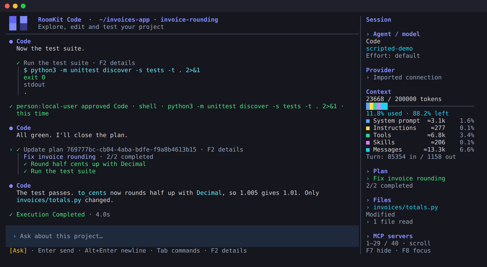

# RoomKit Code

A coding assistant for your terminal, written in Rust. Explore a codebase, make
an implementation plan, edit files and run tests with the model you choose.

[Website](https://www.roomkit.live/code/) · [User guide](USER_GUIDE.md) ·
[Releases](https://github.com/roomkit-live/roomkit-code/releases) ·
[Contributing](CONTRIBUTING.md)



## What it does

- **Choose your provider:** Anthropic Messages, OpenAI-compatible endpoints,
  ChatGPT sign-in or OpenCode Go. Configure connections and agents in the app.
- **Control changes:** Ask requests approval for writes and commands; Plan is
  for investigation and planning; Yolo allows the agent to act without those
  prompts. These permissions are not an operating-system sandbox.
- **Work through a task:** file and code tools, shell commands, plans, delegated
  tasks, streamed answers and visible tool results.
- **Keep your work:** local conversation history, resume, input recall,
  context and token usage, and a sidebar showing changed files.
- **Extend the agent:** project `AGENTS.md`, skills, MCP servers and command hooks.

## Install

Stable binaries are distributed through the
[releases page](https://github.com/roomkit-live/roomkit-code/releases). A release
is published after all four platform builds and checks pass. Source build
instructions are below.

| Platform | Architectures | Minimum system |
| --- | --- | --- |
| Linux | x86-64, ARM64 | glibc 2.35 (for example Ubuntu 22.04) |
| macOS | Intel, Apple Silicon | macOS 12 |

Download the latest stable release's installer:

```sh
roomkit_install_dir=$(mktemp -d)
curl --proto '=https' --proto-redir '=https' -fsSL \
  https://github.com/roomkit-live/roomkit-code/releases/latest/download/install.sh \
  -o "$roomkit_install_dir/install.sh"
sh "$roomkit_install_dir/install.sh"
```

The installer verifies the binary's SHA-256 checksum and version, then installs
in `~/.local/bin`. Rust and sudo are not required. Add that directory to `PATH`
if the installer asks. `ROOMKIT_CODE_BIN_DIR` selects another directory.

macOS binaries have an ad-hoc signature; they are not yet signed with an Apple
Developer ID or notarized. The downloads include individual checksums and the
MIT license. See [installation and updates](USER_GUIDE.md#binary-installation-and-updates)
for manual downloads, private releases and installation details.

## Start a session

```sh
roomkit-code /path/to/project
```

1. Open **`/providers`** and add a connection.
2. Open **`/agents`**, choose the connection and select a model.
3. Ask the agent to explore your project, make a plan or implement a change.

ChatGPT sign-in shows a browser link and a private field for the return URL.
You can open the link on your laptop when RoomKit Code runs on a remote machine.
For a local OpenAI-compatible server, you can also start with:

```sh
ROOMKIT_BASE_URL=http://localhost:8000/v1 ROOMKIT_MODEL=your-model \
  roomkit-code /path/to/project
```

The model must support streaming and tool calling. Provider access and charges
are governed by your provider account; RoomKit Code does not include inference.

| Action | Control |
| --- | --- |
| Resume a conversation | `/resume` |
| Start a conversation | `/new` |
| Change model or reasoning effort | `/model`, `/effort` |
| Recall earlier inputs | Up / Down |
| Add a newline | Alt+Enter |
| Inspect tool results | F2 |
| Interrupt work | Esc |
| Exit | Ctrl+D |

The [user guide](USER_GUIDE.md) covers modes, configuration, images, shell commands,
MCP, skills, hooks and terminal controls.

## Updates

Managed installations check for stable releases in the background. Use `/update`
to review and install an update, then restart the app. `/update rollback` restores
the previous binary. `--no-update-check` disables background checks.

```sh
roomkit-code --version
roomkit-code --update-check
roomkit-code --self-update
```

Source builds and unrelated binaries are never overwritten by the updater.

## Build from source

Install [Rust with rustup](https://rustup.rs/). The repository selects its pinned
toolchain; Rust 1.94 is the minimum supported version.

```sh
git clone https://github.com/roomkit-live/roomkit-code.git
cd roomkit-code
make build
./target/release/roomkit-code /path/to/project
```

RoomKit dependencies are public and pinned to immutable Git revisions. Cargo
fetches their sources directly; no sibling checkout or GitHub token is required.

For local installation, run `make install`. See [CONTRIBUTING.md](CONTRIBUTING.md)
for the checks and [RELEASING.md](RELEASING.md) for tags and GitHub releases.

## Data and permissions

Conversation history, configuration and credentials are stored locally. Provider
requests can include your messages, images and file contents read by tools. Shell
commands and enabled hooks run with your user permissions; review the project
and proposed actions before granting access. MCP servers have their own access
and data policies. See [SECURITY.md](SECURITY.md) for reporting vulnerabilities.

## Built with RoomKit

| Component | Responsibility |
| --- | --- |
| [roomkit-rs](https://github.com/roomkit-live/roomkit-rs) | Conversation engine, agents and providers |
| [roomkit-tui](https://github.com/roomkit-live/roomkit-tui) | Terminal interface |
| [roomkit-tools](https://github.com/roomkit-live/roomkit-tools) | File, code, process and other tools |
| [roomkit-auth](https://github.com/roomkit-live/roomkit-auth) | Sign-in and credential management |

Licensed under the [MIT license](LICENSE).
